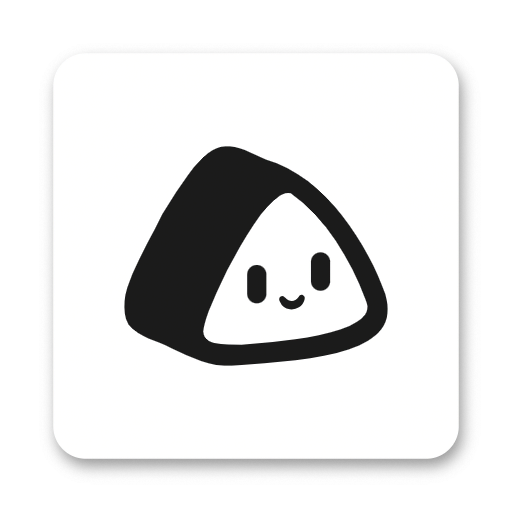

  

<h1 align="center">Findroid+</h1>

A native Jellyfin client for Android with a built-in reader.

Version 1.0.0-beta

Findroid+ is an independent Android client for Jellyfin. It began as a fork of
[Findroid](https://github.com/jarnedemeulemeester/findroid) and builds on its native media
experience while adding a complete reading workflow, a more personal profile system, and a
refined interface.

## Highlights

- Native Android interface built with Jetpack Compose and Material 3
- Movies, TV shows, books, and audiobooks in one library
- Built-in EPUB, PDF, and CBZ reader
- Per-profile PIN protection and profile switching
- Downloads and offline playback
- ExoPlayer and mpv playback engines

## Media playback

- Direct play for movies, episodes, and audiobooks
- ExoPlayer with FFmpeg audio decoding
- Optional mpv playback for difficult formats
- Picture-in-picture mode
- Chapter markers and chapter navigation gestures
- Trickplay thumbnails on supported Jellyfin servers
- Media segment skipping and auto-skip
- Embedded and external subtitles, including SRT, VTT, SSA/ASS, PGSSUB, and DVDSUB
- Preferred audio and subtitle language selection

## Reading

- Dedicated Books tab for books and audiobooks
- Readium-based EPUB, PDF, and CBZ rendering
- Reading progress saved per profile
- Table of contents with hierarchical chapters
- Pull-to-chapter navigation in scroll mode
- Reader font and typography settings
- Author pages and book metadata
- Book downloads and offline reading
- Search, sorting, and display options for the book list

## Profiles and onboarding

- Guided first-time setup for a Jellyfin server and account
- Password or Quick Connect sign-in
- Optional four-digit profile PIN, stored as a salted hash on the device
- Profile picker with admin and guest role badges
- Profile management that respects Jellyfin permissions
- Add and remove profiles without leaving the app
- Persistent logout that returns to profile selection after restart
- Profile switching keeps downloaded media while clearing app caches and reader state

## Downloads and offline use

- Download movies, episodes, books, and audiobooks
- Background downloads with selectable storage
- Offline mode for browsing and playing downloaded content
- Download status and progress on detail pages
- Downloaded items remain available across profile switches

## Interface

- Adaptive bottom navigation and navigation rail
- Immersive detail pages and consistent page transitions
- Shared dialogs, buttons, fields, and menus across the app
- Search, sort, and display controls for media lists
- Optional predictive-back preview
- Configurable grid sizes, artwork ratios, and content spacing

## Requirements

- Android 8.0 or newer
- A Jellyfin server
- Direct network access to the server, or a reachable address while offline mode is disabled

## Project links

- [Findroid+ on GitHub](https://github.com/hdytrfli/findroid)
- [Findroid, the upstream project](https://github.com/jarnedemeulemeester/findroid)
- [Jellyfin](https://jellyfin.org)

## License and attribution

Findroid+ is licensed under the GNU General Public License v3.0. It is an independent fork and is
not affiliated with the Jellyfin project or the Findroid project.

The original Findroid project and its contributors remain the foundation of this work. Playback,
library browsing, and much of the application architecture originate there.

This project also depends on Jellyfin Server and its APIs, the Jellyfin Kotlin SDK, Readium, AndroidX
Media3, mpv, and other open-source libraries.
